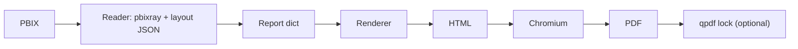

# pbi2html

Convert a Power BI `.pbix` report into an HTML page and a PDF.
People can read the converted report without a Power BI licence.

## Quick start

You need Python 3, Chromium and qpdf installed. From the project folder:

```sh
python3 -m venv .venv && .venv/bin/pip install -r requirements.txt
.venv/bin/python -m pbi2html samples/Revenue-Opportunities.pbix -o out/
```

Open the HTML or PDF in `out/`. Read the warnings in the terminal: they describe parts that may not have converted. The HTML is a static report; cross-filtering is not yet supported.

## Try it safely in Claude Code on the web

Open this repo in Claude Code on the web. It runs in a cloud sandbox, so the conversion does not touch your machine. Drop a `.pbix` in `samples/` and ask Claude to convert it. Use sample data for the demo, not real company data.

## Sharing with executives

Use `--lock` to create a PDF protected with a password. You will be asked to enter it twice:

```sh
.venv/bin/python -m pbi2html samples/Revenue-Opportunities.pbix -o out/ --lock
```

For unattended use, `--password-env NAME` reads a password from an existing environment variable. Do not put the password in the command itself. The HTML is not password protected. For a rollout, put the files in SharePoint or Teams behind work logins, with a VPN as an extra wall. Your IT and security team makes the final call.

## Overnight drop folder

A future scheduled job could convert every new `.pbix` in a folder by morning. It would leave a short note saying what did not convert. This is an idea, not a built feature.

## How it works



## Next

- REA for formats the reader cannot open.
- Mortgage sample data.
- Cross-filtering.
