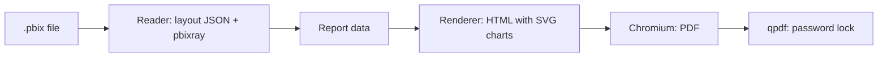

# pbi2html

Turn a Power BI report (`.pbix`) into one HTML page and a password-locked PDF.
Anyone can open the result in a browser or a PDF reader. No Power BI needed.

This is a proof of concept, built in under two hours by AI agents working side by side.

## Quick start

You need Python 3, Chromium and qpdf. From the project folder:

```sh
python3 -m venv .venv && .venv/bin/pip install -r requirements.txt
.venv/bin/python -m pbi2html samples/Revenue-Opportunities.pbix -o out/
```

You get `out/Revenue-Opportunities.html` and `out/Revenue-Opportunities.pdf`.
The terminal lists warnings: parts of the report that did not convert, in plain words.

## Try it safely in Claude Code on the web

1. Open [claude.ai/code](https://claude.ai/code) and pick this repository (github.com/Nigelkil01/pbi2html).
   It runs in a cloud sandbox: nothing touches your computer or company systems.
2. Ask Claude: "Convert samples/Revenue-Opportunities.pbix."
   The project's Claude skill (`.claude/skills/pbi2html/`) sets it up, runs it and explains each warning.
3. To try your own report, add a `.pbix` to `samples/` first. Use sample data, never real company data.


## Sharing with executives

Lock the PDF with a password. You are asked for it twice:

```sh
.venv/bin/python -m pbi2html samples/Revenue-Opportunities.pbix -o out/ --lock
```

For scheduled runs, `--password-env NAME` reads the password from an environment variable.
Never type the password into the command itself.

- The PDF opens in any PDF reader after the password. Nothing new to install.
- The HTML is not locked. Share the PDF, or keep the HTML behind logins.
- For a rollout, keep the files in SharePoint or Teams behind work logins, with the VPN as an extra wall.
  Your IT and security team makes the final call.

## What converts today

| Converts | Shown as "not supported yet" or a warning |
|---|---|
| Pages, positions and titles | Maps, action buttons, multi-field pivot tables |
| Bar, column, line and combo charts | Report, page and visual filters (listed, not applied) |
| Pie, donut and treemap | Complex DAX measures |
| Cards, tables, slicers, text | Hidden pages, themes, colour rules, bookmarks, custom visuals |

The HTML is a static report: clicking one chart does not filter the others.

## How it works



- `pbi2html/read.py` reads the layout and the data model and works out each chart's numbers.
- `pbi2html/render.py` draws the HTML and makes the PDF.
- `pbi2html/__main__.py` is the command.
- How the parts fit: [docs/contract.md](docs/contract.md). Why it is built this way: [docs/adr/](docs/adr/).

## What a teardown with REA found

An agent took `samples/Corporate-Spend.pbix` apart with REA (Reverse Engineer Anything):

- A Power BI file is a ZIP package of 60 separate parts.
- This one has three pages and 20 visuals, including a hidden tooltip page.
- The data model is a separate packed backup using XPress9 compression.
- Two pages carry nine filters; one selects only the year 2014.
- One chart's colours come from a rule driven by a measure.

The reader does not keep hidden pages or colour rules yet, and does not apply filters. Those come next.

## Tests

```sh
.venv/bin/python -m unittest discover tests
```

## Samples

`samples/` holds two of Microsoft's public sample reports
([microsoft/powerbi-desktop-samples](https://github.com/microsoft/powerbi-desktop-samples), MIT licence).

## Next

- Apply filters before working out the numbers.
- Keep hidden pages, themes and colour rules.
- Draw maps.
- Mortgage-style sample data.
- An overnight drop folder: every new `.pbix` in a folder converted by morning, with a note on what did not convert.
